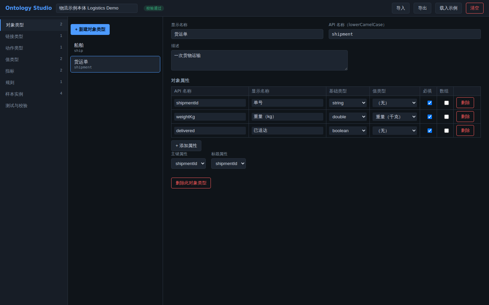
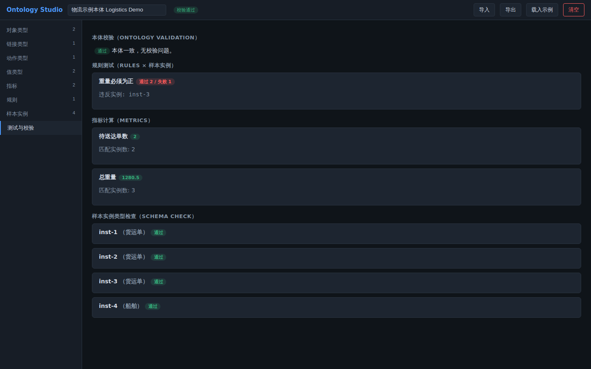
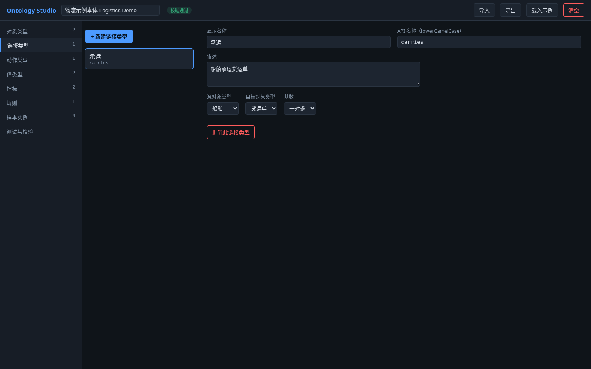
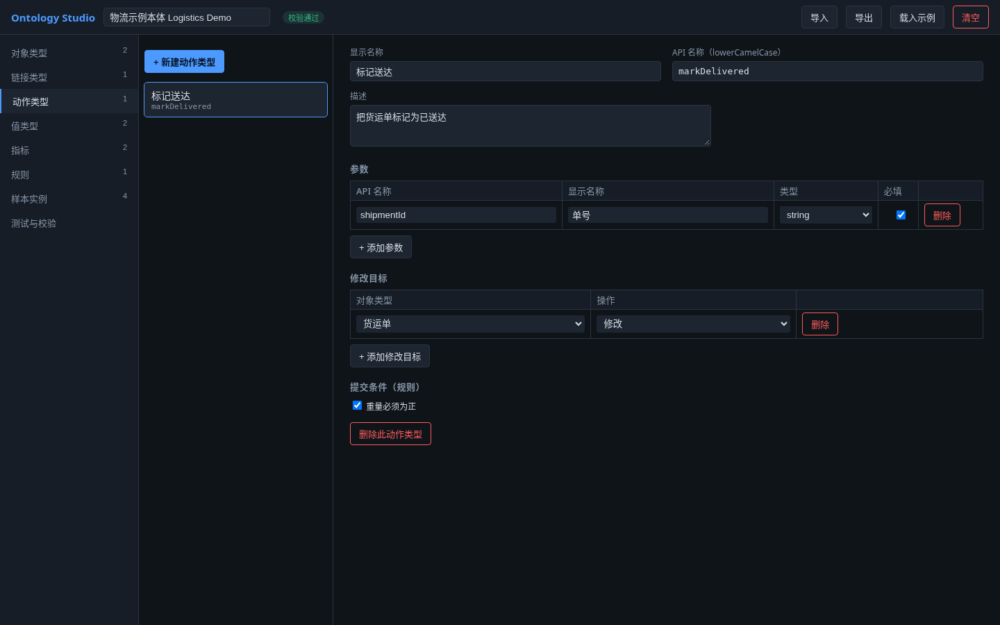
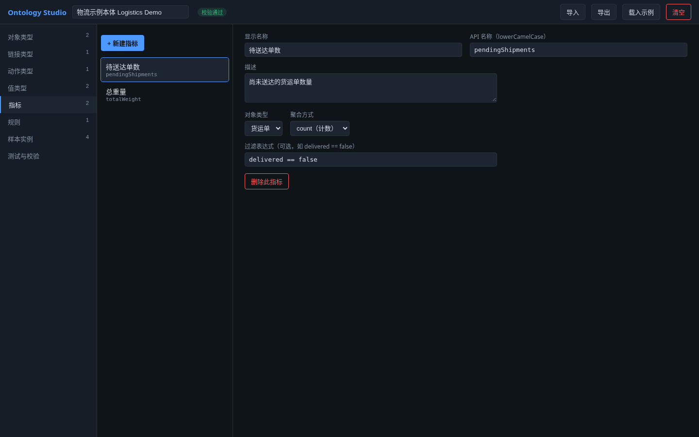
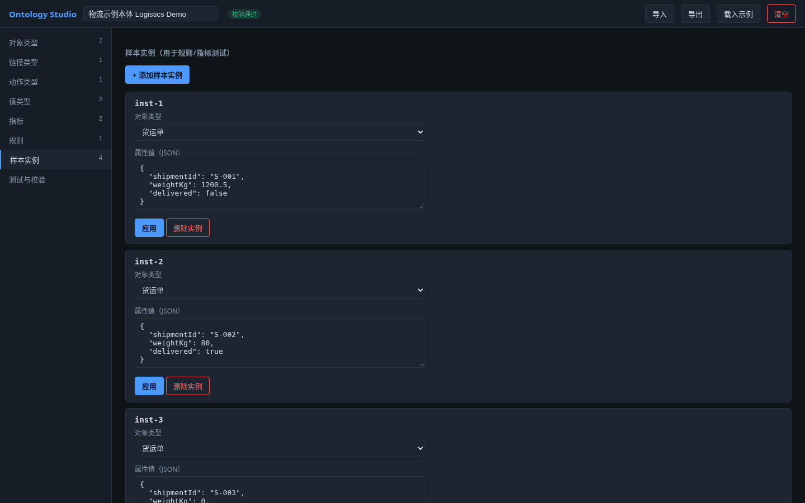

# Ontology Studio

A Palantir-style ontology semantic modeling desktop app (Electron + React + TypeScript). Model a business domain in one semantic layer, with built-in consistency checks and tests for the ontology.

[简体中文](README.md) · **English**

## Features

- Visual editors for six kinds of ontology elements: object types, link types, action types, value types, metrics, and rules.
- Sample instance management (edited as JSON), used to test rules and metrics.
- A "Testing & Validation" panel: ontology validation, rule tests, metric evaluation, and instance type checks. The top bar shows the live validation error count.
- A built-in logistics sample ontology ("Load sample") and a one-click "Clear".
- JSON import / export. Desktop mode auto-saves to the user data directory; browser mode saves to localStorage.

## Screenshots

> The UI is currently Chinese only. Screenshots are of the real app (built with `pnpm run build`, served by `vite preview`, opened in headless Chromium) with the built-in logistics sample ontology.

Object type editor:



Testing & Validation panel (ontology validation, rule tests, metric evaluation, instance type checks):



Link types, action types (parameters, modification targets, submission criteria), metrics (aggregation + filter expression), and sample instances:









## Concepts

| Concept | Description |
|---|---|
| Object Type | A domain entity class with typed **properties**, a primary key, and a title property |
| Link Type | A relationship between two object types (one-to-one / one-to-many / many-to-many) |
| Action Type | A user-initiated change (parameters, modification targets, submission-criteria rules) |
| Value Type | A reusable constrained semantic type (regex / numeric range / enum) |
| Metric | An aggregation over an object type's instances (count / sum / avg / min / max, with an optional filter expression) |
| Rule | A boolean invariant on instances (error / warning); can serve as an action's submission criterion |

## Testing

The "Testing & Validation" panel provides:

- **Ontology validation** — API name conventions and uniqueness, cross-entity reference integrity, expression syntax checks.
- **Rule tests** — run each rule against the sample instances and report pass / fail / violating instances.
- **Metric evaluation** — compute metric values on the fly from their filter and aggregation.
- **Instance type checks** — property-by-property comparison of sample instances against the object type schema.

The expression language supports literals, property identifiers, arithmetic, comparisons, and boolean logic (`&&`/`||`/`!` or `and`/`or`/`not`). Expressions are evaluated in a sandbox with no access to the host.

## Tech stack

| Layer | Technology |
|---|---|
| Desktop shell | Electron 33 (`electron/main.cjs`, `preload.cjs`; file I/O over IPC) |
| UI | React 18 + TypeScript (strict), built with Vite 5 |
| Core | Plain TypeScript: expression engine, validator, test engine, reducer-based state |
| Tests / quality | Vitest 2, ESLint 9 + typescript-eslint |
| Packaging | electron-builder (Linux AppImage) |

## Quick start

Requires Node.js 20+ and pnpm.

```sh
pnpm install
pnpm run dev:desktop   # Vite dev server + Electron window
pnpm run dev           # browser only (persists to localStorage)
```

In desktop mode the ontology is auto-saved to `ontology.json` in the user data directory; JSON files can be imported and exported.

> pnpm 10 and later do not run dependency install scripts by default (pnpm 12 fails outright with `Ignored build scripts: electron, esbuild`), which leaves the Electron binary missing. Run `pnpm approve-builds` and allow `electron` and `esbuild`, or use pnpm 9 (`corepack pnpm@9 install`).

## Development

```sh
pnpm run test        # vitest unit tests (expression engine, validator, test engine, store)
pnpm run typecheck   # strict TypeScript
pnpm run lint        # eslint (typescript-eslint)
pnpm run build       # renderer build into dist/
pnpm run dist        # package a Linux AppImage with electron-builder
```

## Document format

The ontology is persisted as a single JSON document with `formatVersion: 1` (see `Ontology` in `src/core/types.ts`). Documents with an unknown formatVersion are rejected.

## Project structure

```
electron/          Electron main process (main.cjs: window, ontology.json read/write, import/export dialogs) and preload
src/core/          Domain core: types.ts (data model), expression.ts (expression engine), validate.ts (validator),
                   testing.ts (test engine), store.ts (reducer), serialize.ts, sample.ts (sample ontology)
src/ui/            React UI: App.tsx, editors.tsx, fields.tsx, InstancesPanel.tsx, TestPanel.tsx
src/bridge.ts      Persistence bridge: Electron IPC or browser localStorage
tests/             Vitest unit tests (4 files, 28 tests)
build/, public/    Icons
docs/              Screenshots and wiki
```

## Configuration

No environment variables or config files are needed. Data locations:

| Mode | Storage |
|---|---|
| Desktop (Electron) | `app.getPath('userData')/ontology.json` |
| Browser (`pnpm run dev`) | localStorage key `ontology-studio-document` |

The built-in sample ontology is loaded on first launch, or when the stored document can't be parsed.

## Contributing

Issues and pull requests are welcome. Before submitting, make sure `pnpm run test`, `pnpm run typecheck`, and `pnpm run lint` all pass. When you change core logic (`src/core/`), add matching tests under `tests/`.
