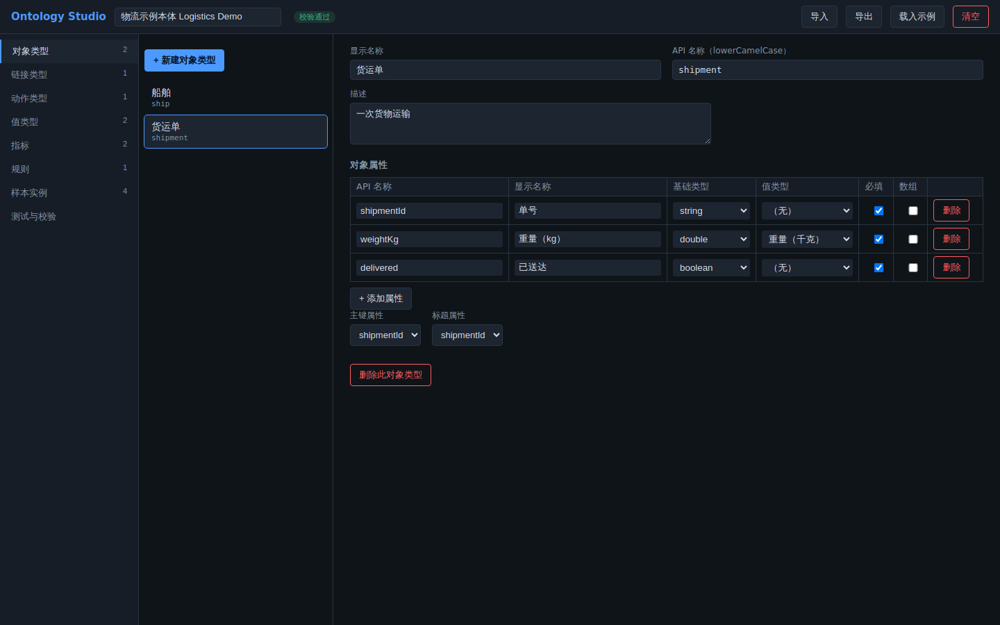
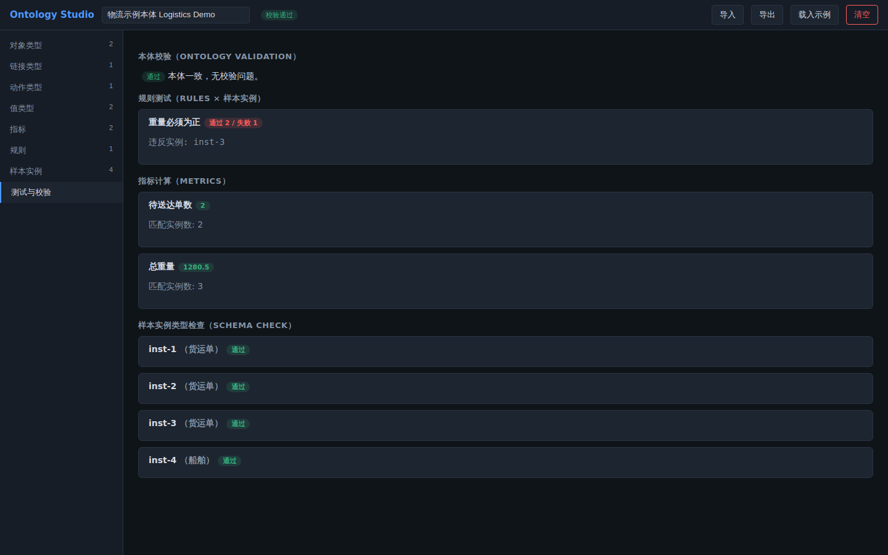

# Ontology Studio

类 Palantir 的本体语义建模桌面程序（Electron + React + TypeScript）。用统一的语义层建模业务领域，并内置对本体的一致性校验与测试。

English: a Palantir-style ontology semantic modeling desktop app with built-in ontology testing.

## 截图

对象类型编辑器（物流示例本体）：



测试与校验面板（本体校验、规则测试、指标计算、实例类型检查）：



## 概念模型

| 概念 | 说明 |
|---|---|
| 对象类型 Object Type | 领域实体类，含类型化的**对象属性**、主键与标题属性 |
| 链接类型 Link Type | 两个对象类型之间的关系（一对一 / 一对多 / 多对多） |
| 动作类型 Action Type | 用户可发起的修改（参数、修改目标、提交条件规则） |
| 值类型 Value Type | 可复用的受约束语义类型（正则 / 数值范围 / 枚举） |
| 指标 Metric | 对某对象类型实例集的聚合（count / sum / avg / min / max，支持过滤表达式） |
| 规则 Rule | 对实例的布尔不变量（error / warning），可作为动作的提交条件 |

## 测试能力

「测试与校验」面板提供：

- **本体校验** — API 名称规范与唯一性、跨实体引用完整性、表达式语法检查。
- **规则测试** — 对样本实例逐条运行规则，报告通过 / 失败 / 违反实例。
- **指标计算** — 按过滤与聚合定义即时计算指标值。
- **实例类型检查** — 样本实例与对象类型属性模式的逐属性核对。

表达式语言支持字面量、属性标识符、四则运算、比较与布尔逻辑（`&&`/`||`/`!` 或 `and`/`or`/`not`），在沙箱内求值，无宿主逃逸。

## 运行

```sh
pnpm install
pnpm run dev:desktop   # Vite 开发服务 + Electron 窗口
pnpm run dev           # 仅浏览器（localStorage 持久化）
```

桌面模式下本体自动保存到用户数据目录的 `ontology.json`，支持导入 / 导出 JSON 文件。

## 开发

```sh
pnpm run test        # vitest 单元测试（表达式引擎、校验器、测试引擎、存储）
pnpm run typecheck   # strict TypeScript
pnpm run lint        # eslint (typescript-eslint)
pnpm run build       # 渲染层产物 dist/
pnpm run dist        # electron-builder 打包 Linux AppImage
```

## 文档格式

本体持久化为 `formatVersion: 1` 的单一 JSON 文档（见 `src/core/types.ts` 的 `Ontology`）。未知的 formatVersion 会被拒绝加载。
