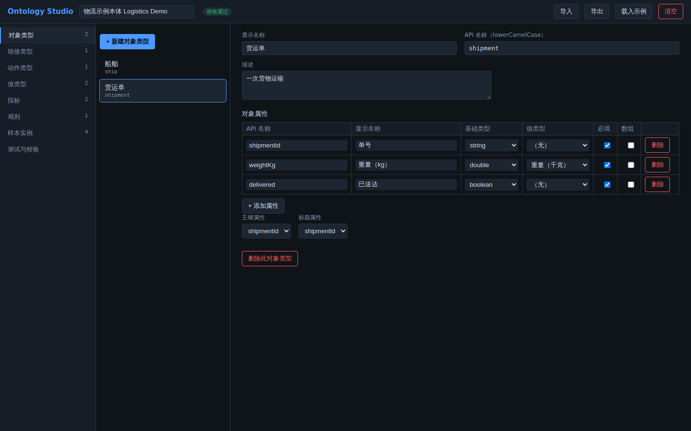
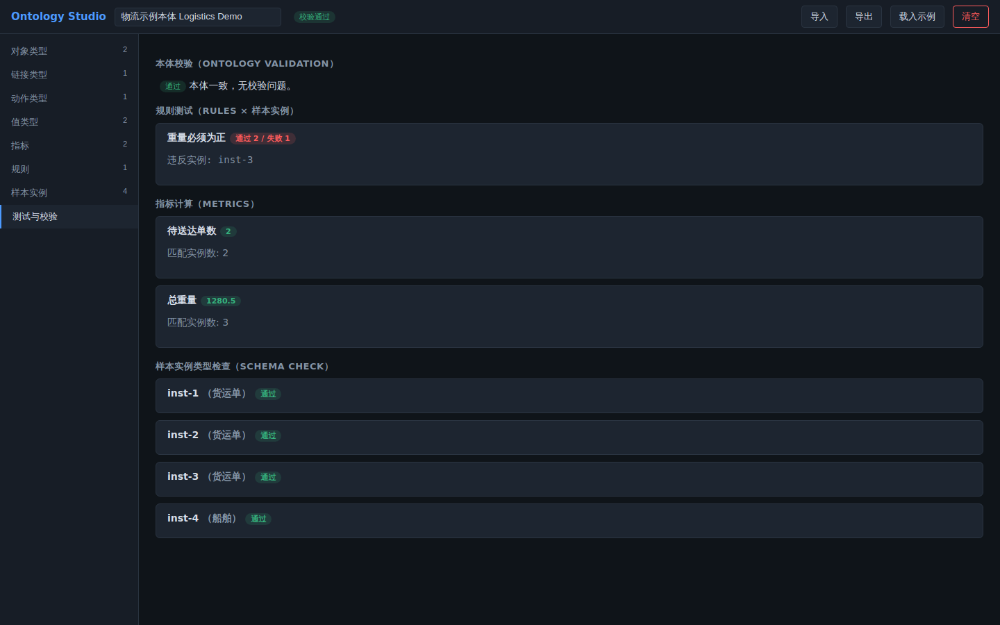

# Ontology Studio

[简体中文](README.md) · [English](README.en.md)

类 Palantir 的本体语义建模桌面程序（Electron + React + TypeScript）。用统一的语义层建模业务领域，并内置对本体的一致性校验与测试。

English: a Palantir-style ontology semantic modeling desktop app with built-in ontology testing.

## 下载

发行页：[GitHub Releases v0.1.0](https://github.com/gatesenman/ontology-studio/releases/tag/v0.1.0)

- Linux x86_64 AppImage：[Ontology-Studio-0.1.0-linux-x86_64.AppImage](https://github.com/gatesenman/ontology-studio/releases/download/v0.1.0/Ontology-Studio-0.1.0-linux-x86_64.AppImage)（217,094,843 字节，SHA256 `f4f6f9180af67bded2c68450547135ed42e10c19d779b1578cbeb10f63e4a4f2`）

当前**没有**已发布的 Windows 安装包或便携包。`package.json` 里 electron-builder 只配置了 Linux AppImage。本轮因磁盘空间不足，未在 Linux 上交叉打包 Windows。桌面运行可用下方源码命令。

## 截图

以下两张是仓库已有的真实产品界面（中文 UI，内置物流示例本体）。English README 说明拍摄方式为：`pnpm run build` 后用 `vite preview`，再在无头 Chromium 中打开。不是生成图。

仓库里另有 `docs/screenshots/ontology-studio-main.jpg`，画面带有 “Palantir Technologies Inc.” 版权与英文 Palantir 风格界面，**不能**当作本产品截图，故不在 README 中引用。

对象类型编辑器（物流示例本体）：



测试与校验面板（本体校验、规则测试、指标计算、实例类型检查）：



## 概念模型

| 概念 | 说明 |
|---|---|
| 对象类型 Object Type | 领域实体类，含类型化的**对象属性**、主键与标题属性 |
| 链接类型 Link Type | 两个对象类型之间的关系（一对一 / 一对多 / 多对多） |
| 动作类型 Action Type | 用户可发起的修改（参数、修改目标、提交条件规则） |
| 值类型 Value Type | 可复用的受约束语义类型（正则 / 数值范围 / 枚举） |
| 指标 Metric | 对某对象类型实例集的聚合（count / sum / avg / min / max，支持过滤表达式） |
| 规则 Rule | 对实例的布尔不变量（error / warning），可作为动作的提交条件 |

## 测试能力

「测试与校验」面板提供：

- **本体校验** — API 名称规范与唯一性、跨实体引用完整性、表达式语法检查。
- **规则测试** — 对样本实例逐条运行规则，报告通过 / 失败 / 违反实例。
- **指标计算** — 按过滤与聚合定义即时计算指标值。
- **实例类型检查** — 样本实例与对象类型属性模式的逐属性核对。

表达式语言支持字面量、属性标识符、四则运算、比较与布尔逻辑（`&&`/`||`/`!` 或 `and`/`or`/`not`），在沙箱内求值，无宿主逃逸。

## 运行

```sh
pnpm install
pnpm run dev:desktop   # Vite 开发服务 + Electron 窗口
pnpm run dev           # 仅浏览器（localStorage 持久化）
```

桌面模式下本体自动保存到用户数据目录的 `ontology.json`，支持导入 / 导出 JSON 文件。

## 开发

```sh
pnpm run test        # vitest 单元测试（表达式引擎、校验器、测试引擎、存储）
pnpm run typecheck   # strict TypeScript
pnpm run lint        # eslint (typescript-eslint)
pnpm run build       # 渲染层产物 dist/
pnpm run dist        # electron-builder 打包 Linux AppImage
```

## 文档格式

本体持久化为 `formatVersion: 1` 的单一 JSON 文档（见 `src/core/types.ts` 的 `Ontology`）。未知的 formatVersion 会被拒绝加载。

## 限制

- 已发布资产仅有 Linux AppImage，未签名；尚未提供 Windows / macOS 安装包。
- 界面目前主要为中文。
- 本仓库尚未附带 LICENSE 文件（只陈述现状，不代选许可证）。

## 贡献

欢迎通过 Issue 和 Pull Request 参与，详见 [CONTRIBUTING.md](CONTRIBUTING.md)。安全问题请按 [SECURITY.md](SECURITY.md) 私下报告。参与时请遵守 [CODE_OF_CONDUCT.md](CODE_OF_CONDUCT.md)。

## 许可证

本仓库尚未附带 LICENSE 文件，许可证未指定。

