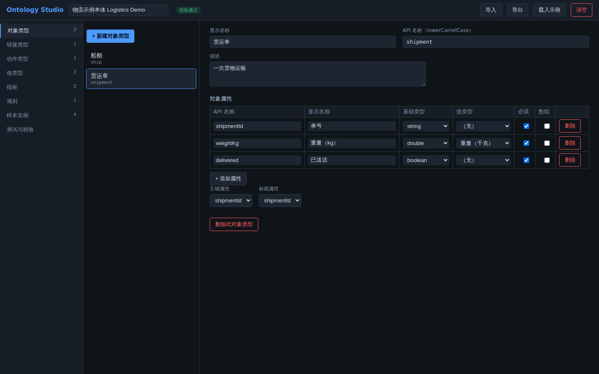
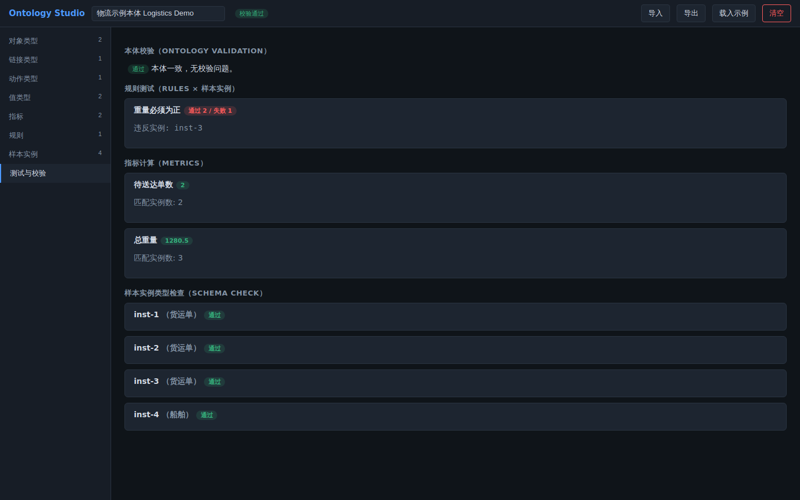
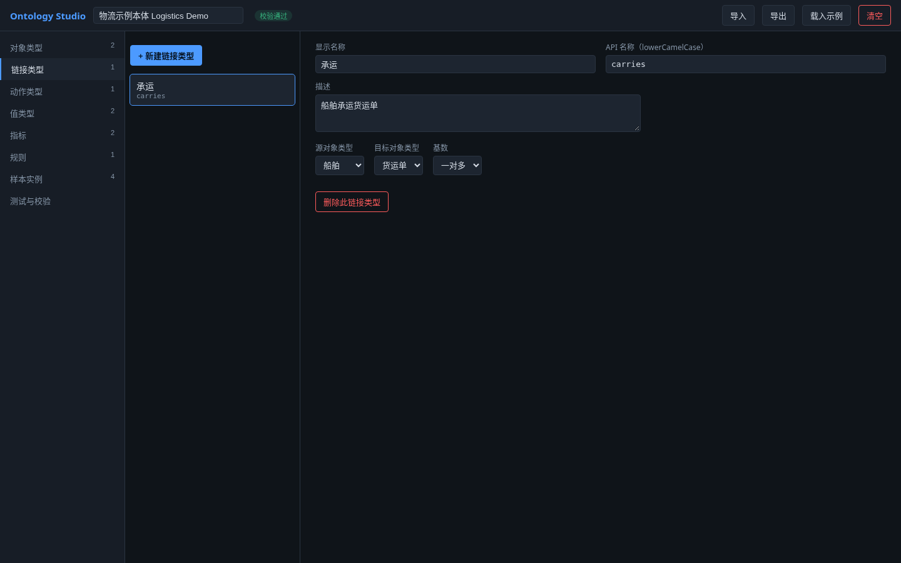
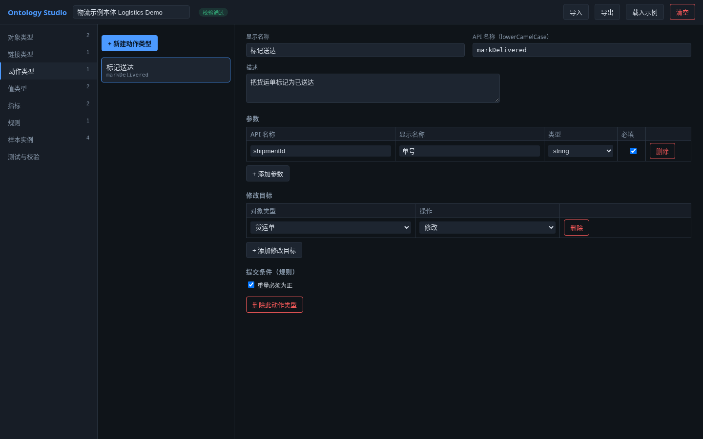
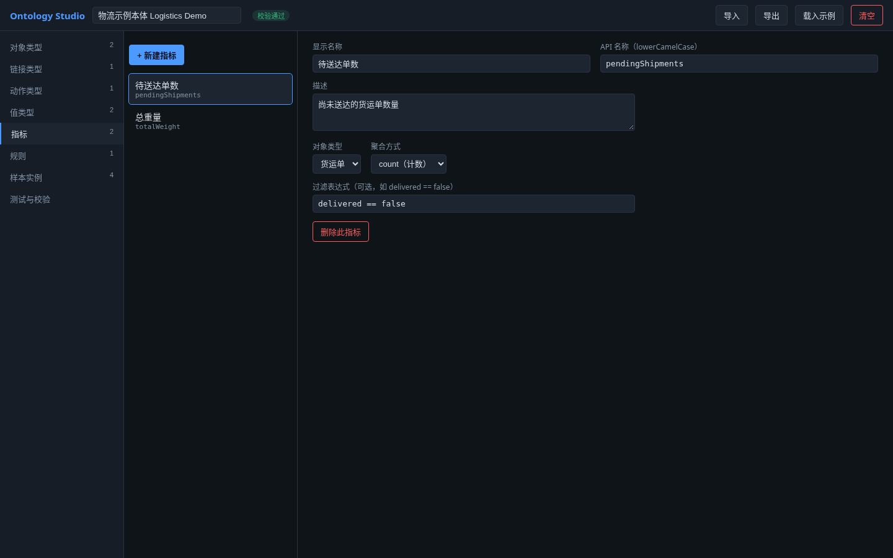
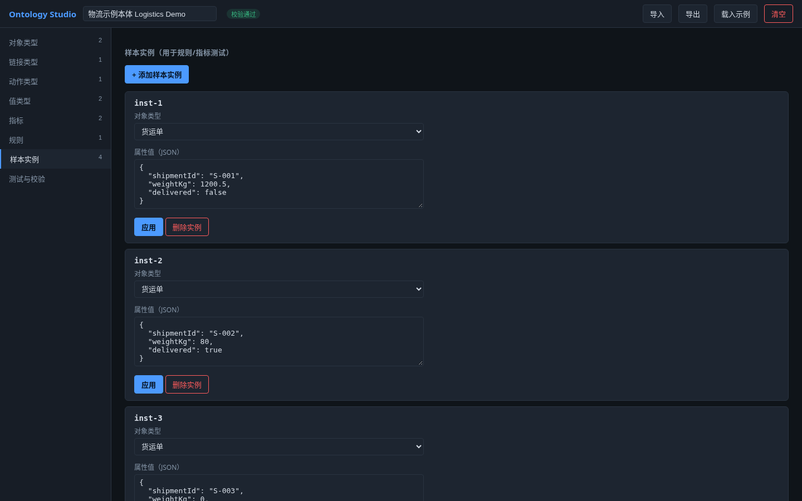

# Ontology Studio

类 Palantir 的本体语义建模桌面程序（Electron + React + TypeScript）。用统一的语义层建模业务领域，并内置对本体的一致性校验与测试。

**简体中文** · [English](README.en.md)

## 功能

- 六类本体元素的可视化编辑：对象类型、链接类型、动作类型、值类型、指标、规则。
- 样本实例管理（JSON 编辑），用于规则与指标测试。
- 「测试与校验」面板：本体校验、规则测试、指标计算、实例类型检查；顶栏实时显示校验错误数。
- 内置物流示例本体（「载入示例」），一键清空。
- 导入 / 导出 JSON；桌面模式自动保存到用户数据目录，浏览器模式保存到 localStorage。

## 截图

对象类型编辑器（物流示例本体）：



测试与校验面板（本体校验、规则测试、指标计算、实例类型检查）：



链接类型、动作类型（参数、修改目标、提交条件）、指标（聚合 + 过滤表达式）和样本实例：









> 截图来自 `pnpm run build` 后用 `vite preview` 在无头 Chromium 中打开的真实界面（内置物流示例本体）。界面目前只有中文。

## 技术栈

| 层 | 技术 |
|---|---|
| 桌面外壳 | Electron 33（`electron/main.cjs`、`preload.cjs`，IPC 读写文件） |
| 界面 | React 18 + TypeScript（strict），Vite 5 构建 |
| 核心 | 纯 TypeScript：表达式引擎、校验器、测试引擎、reducer 状态管理 |
| 测试 / 质量 | Vitest 2、ESLint 9 + typescript-eslint |
| 打包 | electron-builder（Linux AppImage） |

## 概念模型

| 概念 | 说明 |
|---|---|
| 对象类型 Object Type | 领域实体类，含类型化的**对象属性**、主键与标题属性 |
| 链接类型 Link Type | 两个对象类型之间的关系（一对一 / 一对多 / 多对多） |
| 动作类型 Action Type | 用户可发起的修改（参数、修改目标、提交条件规则） |
| 值类型 Value Type | 可复用的受约束语义类型（正则 / 数值范围 / 枚举） |
| 指标 Metric | 对某对象类型实例集的聚合（count / sum / avg / min / max，支持过滤表达式） |
| 规则 Rule | 对实例的布尔不变量（error / warning），可作为动作的提交条件 |

## 测试能力

「测试与校验」面板提供：

- **本体校验** — API 名称规范与唯一性、跨实体引用完整性、表达式语法检查。
- **规则测试** — 对样本实例逐条运行规则，报告通过 / 失败 / 违反实例。
- **指标计算** — 按过滤与聚合定义即时计算指标值。
- **实例类型检查** — 样本实例与对象类型属性模式的逐属性核对。

表达式语言支持字面量、属性标识符、四则运算、比较与布尔逻辑（`&&`/`||`/`!` 或 `and`/`or`/`not`），在沙箱内求值，无宿主逃逸。

## 运行

需要 Node.js 20+ 和 pnpm。

```sh
pnpm install
pnpm run dev:desktop   # Vite 开发服务 + Electron 窗口
pnpm run dev           # 仅浏览器（localStorage 持久化）
```

桌面模式下本体自动保存到用户数据目录的 `ontology.json`，支持导入 / 导出 JSON 文件。

> pnpm 10 及以上默认不运行依赖的安装脚本（实测 pnpm 12 会直接报错 `Ignored build scripts: electron, esbuild`），导致 Electron 二进制缺失。请执行 `pnpm approve-builds` 允许 `electron` 和 `esbuild`，或使用 pnpm 9（`corepack pnpm@9 install`）。

## 开发

```sh
pnpm run test        # vitest 单元测试（表达式引擎、校验器、测试引擎、存储）
pnpm run typecheck   # strict TypeScript
pnpm run lint        # eslint (typescript-eslint)
pnpm run build       # 渲染层产物 dist/
pnpm run dist        # electron-builder 打包 Linux AppImage
```

## 文档格式

本体持久化为 `formatVersion: 1` 的单一 JSON 文档（见 `src/core/types.ts` 的 `Ontology`）。未知的 formatVersion 会被拒绝加载。

## 项目结构

```
electron/          Electron 主进程（main.cjs：窗口、ontology.json 读写、导入/导出对话框）与 preload
src/core/          领域核心：types.ts（数据模型）、expression.ts（表达式引擎）、validate.ts（校验器）、
                   testing.ts（测试引擎）、store.ts（reducer）、serialize.ts、sample.ts（示例本体）
src/ui/            React 界面：App.tsx、editors.tsx、fields.tsx、InstancesPanel.tsx、TestPanel.tsx
src/bridge.ts      持久化桥：Electron IPC 或浏览器 localStorage
tests/             Vitest 单元测试（4 个文件，28 个用例）
build/、public/    图标
docs/              截图与 wiki
```

## 配置

无需环境变量或配置文件。数据位置：

| 模式 | 存储位置 |
|---|---|
| 桌面（Electron） | `app.getPath('userData')/ontology.json` |
| 浏览器（`pnpm run dev`） | localStorage 键 `ontology-studio-document` |

首次启动（或存储内容无法解析）时会载入内置示例本体。

## 参与贡献

欢迎 Issue 和 PR。提交前请确认 `pnpm run test`、`pnpm run typecheck`、`pnpm run lint` 全部通过；修改核心逻辑（`src/core/`）时请在 `tests/` 中补充对应测试。
