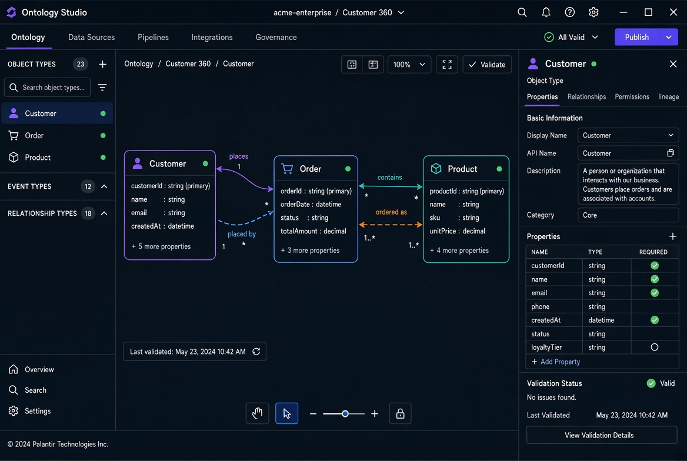

# Ontology Studio 文档中心

Ontology Studio 是一款类 Palantir 的本体语义建模桌面应用（Electron + React + TypeScript），内置本体一致性校验与测试能力。

## 界面预览

## 核心能力

- 对象类型（Object Type）建模
- 链接类型（Link Type）关系定义
- 动作类型（Action Type）
- 内置校验与测试面板
- 指标与规则定义

## 快速开始

详见 [Getting Started](Getting-Started.md)
